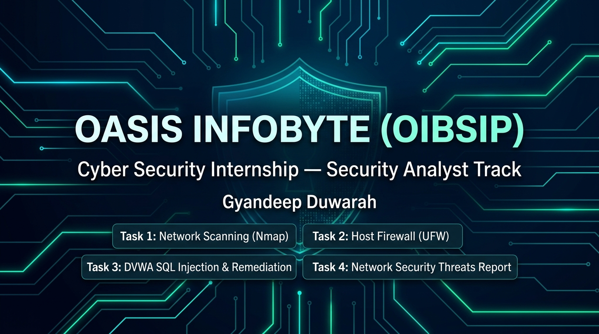

# Oasis Infobyte (OIBSIP) — Cyber Security Internship



**Intern**: Gyandeep Duwarah  
**Track**: Cyber Security  
**GitHub**: [@codewithgyan467](https://github.com/codewithgyan467)

---

## Overview

This repository contains my completed tasks for the Oasis Infobyte Cyber Security Internship program. Each task includes practical implementation scripts, scan logs, detailed notes, and verification screenshots.

---

## Tasks Summary

### [Task 1: Basic Network Scanning with Nmap](./CyberSecurity-Task1-Nmap/)
- **Objective**: Perform host discovery, port scanning, and service version enumeration on local target.
- **Target**: `127.0.0.1` (Localhost)
- **Key Commands**:
  - `nmap 127.0.0.1` — Top 1000 ports TCP scan
  - `nmap -sV 127.0.0.1` — Service & version detection
  - `nmap -sV -oN nmap_scan_results.txt 127.0.0.1` — Export scan output
- **Deliverables**: [Scan Output Log](./CyberSecurity-Task1-Nmap/nmap_scan_results.txt) and terminal screenshots.

---

### [Task 2: Firewall Configuration with UFW](./CyberSecurity-Task2-UFW/)
- **Objective**: Configure and harden host-based firewall policies using Ubuntu's Uncomplicated Firewall (UFW).
- **Rules Configured**:
  - Default incoming policy: **DENY**
  - Default outgoing policy: **ALLOW**
  - Allow SSH (Port 22/tcp) with rate-limiting
  - Deny HTTP (Port 80/tcp)
  - Allow HTTPS (Port 443/tcp)
  - Allow Loopback interface (`lo`)
- **Deliverables**: Shell script [ufw_configuration.sh](./CyberSecurity-Task2-UFW/ufw_configuration.sh) and verification screenshots (`ufw status verbose`, `ufw status numbered`).

---

### [Task 3: SQL Injection Testing & Remediation](./CyberSecurity-Task3-DVWA-SQLInjection/)
- **Objective**: Identify, exploit, and remediate SQL Injection vulnerabilities in Damn Vulnerable Web Application (DVWA) on Low security.
- **Key Highlights**:
  - Baseline legitimate query testing (`id=1`)
  - Boolean-based bypass (`1' OR '1'='1`)
  - UNION-based database extraction (`1' UNION SELECT user, password FROM users #`)
  - Secure code remediation using PHP PDO prepared statements with parameterized inputs.
- **Deliverables**: Full documentation in [sql_injection_notes.md](./CyberSecurity-Task3-DVWA-SQLInjection/sql_injection_notes.md) and proof-of-concept screenshots.

---

### [Task 4: Network Security Threats Report](./CyberSecurity-Task4-NetworkThreatsReport/)
- **Objective**: In-depth research and comparative analysis of critical network security threats.
- **Topics Covered**:
  1. Denial of Service (DoS) and Distributed Denial of Service (DDoS)
  2. Man-in-the-Middle (MitM) Attacks
  3. IP Address Spoofing
  4. DNS Cache Poisoning & DNS Spoofing
- **Deliverables**: Comprehensive technical report in [network_security_threats_report.md](./CyberSecurity-Task4-NetworkThreatsReport/network_security_threats_report.md) with attack flow diagrams, real-world case studies (Mirai, DigiNotar, GitHub Memcached, Malaysia Airlines), mitigation techniques, and a threat comparison matrix.

---

## Repository Structure

```text
OIBSIP/
├── .gitignore
├── README.md
├── title_card.jpg
├── CyberSecurity-Task1-Nmap/
│   ├── README.md
│   ├── nmap_scan_results.txt
│   └── screenshots/
├── CyberSecurity-Task2-UFW/
│   ├── README.md
│   ├── ufw_configuration.sh
│   └── screenshots/
├── CyberSecurity-Task3-DVWA-SQLInjection/
│   ├── README.md
│   ├── sql_injection_notes.md
│   └── screenshots/
└── CyberSecurity-Task4-NetworkThreatsReport/
    ├── README.md
    └── network_security_threats_report.md
```

---

## Author

- **Gyandeep Duwarah**
- **GitHub**: [codewithgyan467](https://github.com/codewithgyan467)
- **Email**: duwarahgyandeep248@gmail.com
